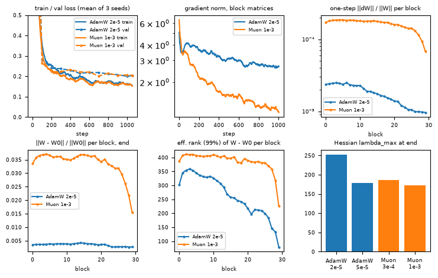

# AdamW vs Muon: Diagnosing Optimization during Fine-Tuning

**Report:** [`AdamW_vs_Muon_report.pdf`](AdamW_vs_Muon_report.pdf) (one page: setup, metrics, results table, and answers to the four task questions).

## Problem

DAPLab recruitment task (post-training optimization). A small LM is fine-tuned on SST-2 with AdamW and with Muon. The task is to diagnose how the two optimizers differ, not just in accuracy but in the trajectory they take and the solution they land in.

## Approach

- **Model and data.** SmolLM2-135M on SST-2, with a linear head on the last token. One epoch, batch size 64, constant learning rate, the same data order for every run.
- **Muon setup.** Muon (1e-3) on the 210 block matrices, plus AdamW (2e-5) on the embedding, norms and head.
- **AdamW setup.** AdamW (2e-5) on all 273 parameters.
- **Runs.** The main pair (AdamW 2e-5 against Muon 1e-3) uses 3 seeds each. Single-seed ablations cover learning rate (both optimizers), Muon momentum and weight decay.
- **Metrics.** Outcome: validation loss and accuracy, and train loss. Trajectory:
  - the gradient norm of the block matrices;
  - the one-step update size ‖ΔW‖/‖W‖ and its stable rank;
  - drift ‖W−W0‖/‖W0‖ and the effective rank of W−W0;
  - Hessian λmax by power iteration, with the loss increase for an uphill step along the gradient as a check.

## Results



Figure 1 of the report, main pair, mean of 3 seeds. The panels are:
- (a) train and validation loss;
- (b) gradient norm of the block matrices;
- (c) one-step relative update per block;
- (d) drift from the pretrained weights per block at the end;
- (e) effective rank of W−W0 per block;
- (f) λmax at the end of training.

Validation results on the SST-2 validation split (872 examples). The numbers are the saved outputs of `final_analysis.ipynb`.

| optimizer | best val acc | final val acc | final val loss | weight drift ‖W−W0‖/‖W0‖ | Hessian λmax at end |
|---|---|---|---|---|---|
| AdamW 2e-5 | 0.935 ± 0.002 | 0.929 ± 0.002 | 0.204 | 0.0035 | 253 ± 20 |
| Muon 1e-3 | 0.930 ± 0.005 | 0.920 ± 0.004 | 0.205 | 0.0337 | 172 ± 33 |

The two optimizers reach similar accuracy and loss, but they end in different places:
- **Drift.** Muon moves the weights about 10 times further from the pretrained values.
- **Flatness.** Muon lands in a flatter region (lower λmax).
- **Update rank.** Muon's one-step updates have a mean stable rank of about 215, against about 4 for AdamW.

Across the ablations (`final_analysis.ipynb`, all 17 runs):
- The best single validation accuracy is 0.937 (AdamW 2e-5 with weight decay 0.01).
- Muon at 3e-3 drops to a final accuracy of 0.890.
- Muon without momentum ends at a validation loss of 0.337.

## Evidence

- [`AdamW_vs_Muon_report.pdf`](AdamW_vs_Muon_report.pdf): Table 1 has all configurations, and the text answers the four task questions:
  - which optimizer performed better;
  - which solution is flatter;
  - how reliable the conclusions are;
  - what to change in a larger study.
- `fig1.png`: Figure 1 of the report, exported from the saved output of `final_analysis.ipynb`.
- `final_analysis.ipynb`: the saved outputs include:
  - the per-run metrics;
  - the main-pair summary;
  - the table of all configurations;
  - the momentum ablation;
  - two supplementary figures (drift and λmax against learning rate, and validation accuracy for every run).
- `train_multi_config.ipynb`: the saved training logs and the per-run final and best accuracy table.

## Reproduction

```
pip install torch>=2.9 transformers datasets matplotlib tqdm
```

Two notebooks:
- `train_multi_config.ipynb`: config-driven training. Each entry in `configs` is one run, and each run saves `ckpt/<run>/logs.json` and weights at several steps.
- `final_analysis.ipynb`: computes the metrics from the checkpoints, caches them in `stats.json`, and makes the report figure and tables.

Run all cells of `train_multi_config.ipynb` first. It skips any run whose `logs.json` already exists. Then run `final_analysis.ipynb`. Both work on CUDA or Apple MPS. The results in the report were produced on an MPS device (local training on an M5 MacBook).

## Limitations

From the report:
- **Narrow setting.** The conclusions hold for one setting: a 135M model, a near-saturated classification task, and full fine-tuning from an Adam-pretrained checkpoint at a constant learning rate. Nothing here transfers to pretraining or RL.
- **Statistical precision.** The validation set has 872 examples, so the standard error of accuracy is about 0.009. The accuracy gap between the main pair is within that.
- **Few runs per comparison.** The learning-rate-matched sharpness comparison rests on two configurations. The momentum and weight-decay rows are single-seed.
- **Next steps the report suggests.** A task without a ceiling (MNLI, or generative SFT on GSM8K), larger models, RL, a Muon-pretrained checkpoint, learning-rate decay, more seeds per learning rate, and tuned weight-decay values.
